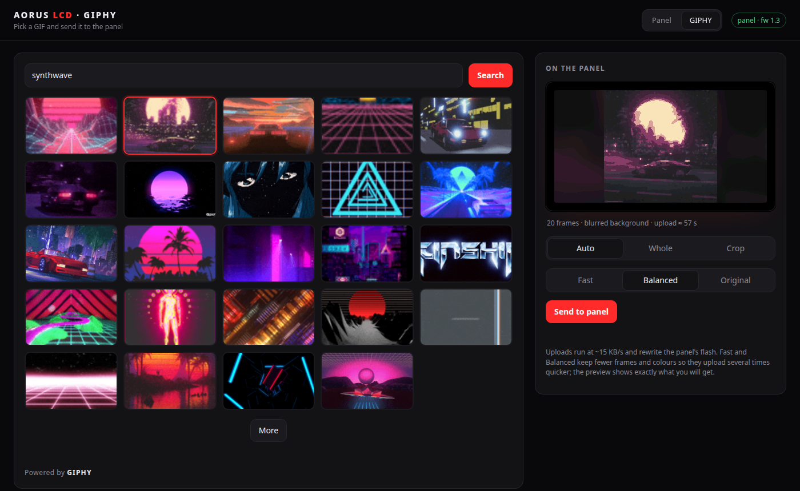
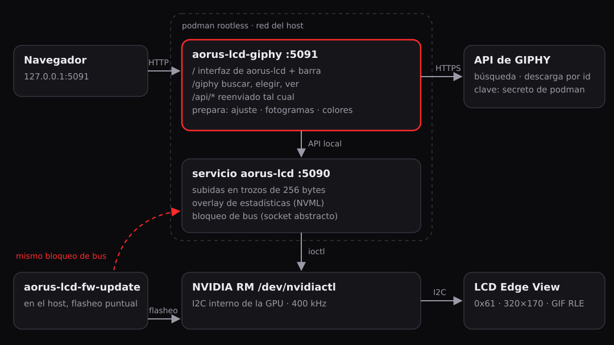
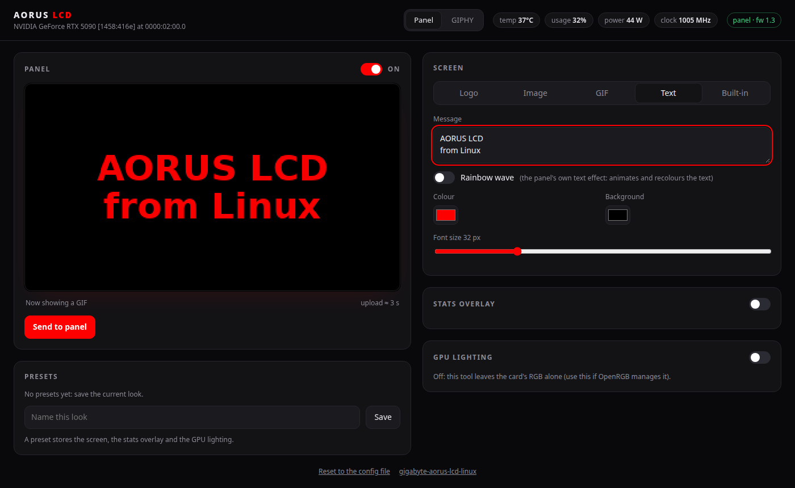
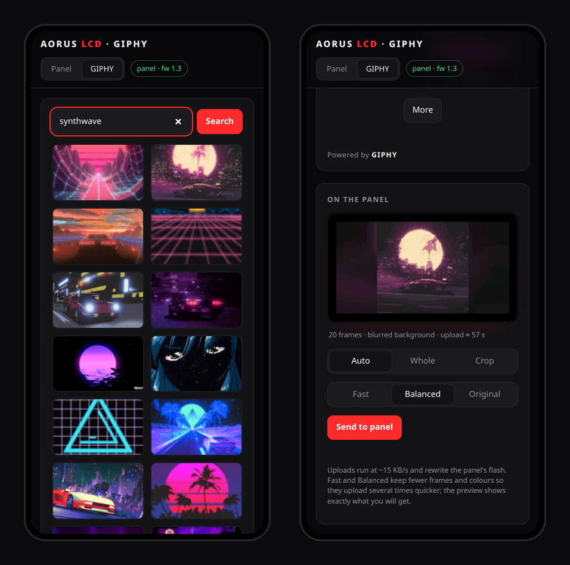
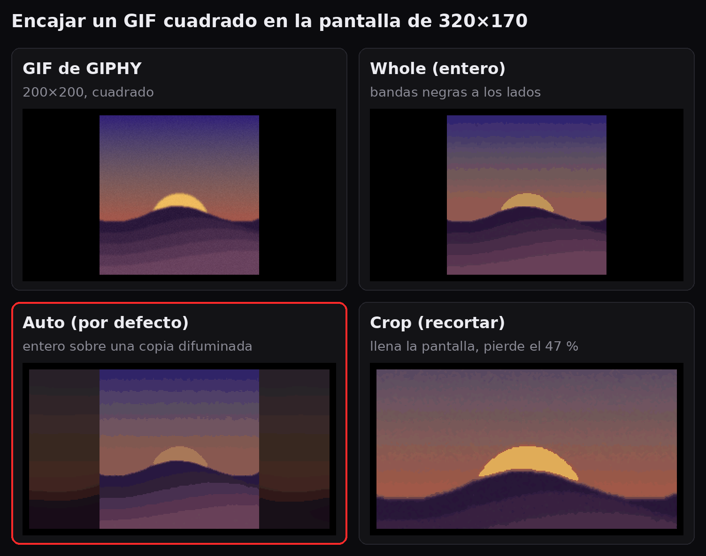
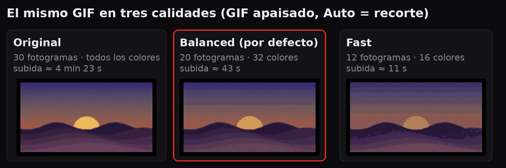
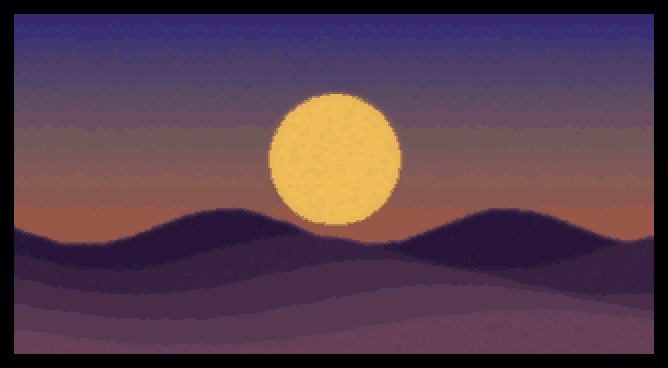

# aorus-lcd-extras

[English](README.md) · **Español**

Complementos para [`aorus-lcd`](https://github.com/c-drew/gigabyte-aorus-lcd-linux), que controla
desde Linux la pantalla lateral **LCD Edge View**:

- **`aorus-lcd-fw-update`**: actualiza el firmware del panel con el panel funcionando (abajo).
- **Un contenedor rootless** para el servicio y la interfaz web de `aorus-lcd`, para cambiar lo
  que muestra la pantalla ([El servicio del panel en un
  contenedor](#el-servicio-del-panel-en-un-contenedor)).
- **`aorus-lcd-giphy`**: una página para buscar en GIPHY y enviar un GIF al panel
  ([GIPHY](#giphy)).



## Actualización de firmware

Actualiza desde Linux el firmware de la pantalla lateral **LCD Edge View** de una Gigabyte
**AORUS GeForce RTX 5090 MASTER**, con el panel **funcionando con normalidad**. No hace falta
Windows, ni Gigabyte Control Center, ni root.

```bash
aorus-lcd-fw-update extract GV-N5090AORUSM-32GD_LCD_F1.3.exe -o lcd-f1.3.bin
aorus-lcd-fw-update flash lcd-f1.3.bin          # solo comprueba, no escribe nada
aorus-lcd-fw-update flash lcd-f1.3.bin --yes    # ~2 minutos, no apagues
```

## Por qué existe

[c-drew/gigabyte-aorus-lcd-linux](https://github.com/c-drew/gigabyte-aorus-lcd-linux)
(`aorus-lcd`) ya controla el panel desde Linux y puede reflashearlo exactamente igual que el
actualizador de Gigabyte. Pero solo lo hace cuando el microcontrolador del panel **ya está
atascado en su bootloader IAP**. Un panel sano ejecuta su aplicación en la dirección I2C
`0x61`, y nadie había documentado cómo lo manda el actualizador de Gigabyte al bootloader.
Este proyecto añade justo ese paso y después cede el control al plan de flasheo verificado de
`aorus-lcd`. Es un complemento pequeño, no un fork.

## El paso que faltaba: `I2CAPChangeToIAP`

Sale de `GvLcdFwUpdate.dll`, que viene dentro del actualizador oficial
`GV-N5090AORUSM-32GD_LCD_F1.3.exe`:

1. `I2CAPChangeToIAP` (RVA `0x35B0`) arma `{cmd = 0x8101, byte de longitud = 4}` y llama al
   escritor de tramas `0x4060`. Ese escritor es el mismo de `I2CIAPChangeToAP` (`0x8102`), que
   `aorus-lcd` ya reproduce y tiene verificado en emulador. El escritor añade `~cmd` y un
   CRC-16/XMODEM del bloque `[len][crc]`, calculado con el campo del CRC a cero. En el bus,
   hacia `0x61` (`0xC2` en 8 bits), queda así:

   ```
   01 81 FE 7E 04 00 F1 CA
   ```

2. El escritor espera 100 ms y **lee 4 bytes de la dirección de la aplicación** (helper
   `0x3B30`: una lectura simple, sin escribir antes). Repite la lectura cada 1 ms, hasta 3000
   veces, hasta que la respuesta no sea cero. El panel contesta `01 5A FE A5` y se reinicia en
   su bootloader.
3. El flujo de Gigabyte espera 500 ms y empieza a hablar con el bootloader en `0x22` (o en
   `0x23` como alternativa). A partir de ahí se usa `firmware.plan_flash` de `aorus-lcd` tal
   cual.

**La lectura del paso 2 es imprescindible.** En el primer intento, la herramienta enviaba la
trama y después solo hacía un ping. El panel ignoró la petición, se quedó con su firmware y
no se borró nada. Con la lectura, pasó al bootloader en el acto. Encaja con el manejador del
propio firmware del panel
([análisis de EKYavsil](https://github.com/EKYavsil/aorus-lcd-panel-reverse-engineering)),
que espera un mensaje de 8 bytes que empiece por `0x8101 0x7EFE`.

Puedes comprobarlo con tu propia descarga, sin ejecutar nada de Gigabyte:

```bash
.venv/bin/pip install -e '.[verify]'
.venv/bin/python -I tools/verify_dll.py GV-N5090AORUSM-32GD_LCD_F1.3.exe
```

## Estado

Probado **una vez**, en una sola tarjeta: AORUS GeForce RTX 5090 MASTER 32G (subsistema PCI
`1458:416e`), LCD de la **1.1 a la 1.3**, driver NVIDIA 615.78.08, Bazzite (Fedora 44, kernel
7.2). Se agradecen pruebas con otras tarjetas.

Solo acepta imágenes que `aorus-lcd` reconoce por su SHA-256, y solo en la tarjeta a la que
pertenecen. Hoy eso significa la F1.3 para `1458:416e`, que es la más reciente que publica
Gigabyte para esta tarjeta. Las F1.4 y F1.5 que circulan son de los modelos MASTER ICE y
STEALTH ICE.

## Instalación

Necesita Python 3.11+ y el driver de NVIDIA (abierto o propietario). Accede por
`/dev/nvidiactl`, igual que las librerías de NVIDIA, así que no hacen falta root ni i2c-dev.

```bash
git clone https://github.com/jfrmorales/aorus-lcd-extras
cd aorus-lcd-extras
python3 -m venv .venv && .venv/bin/pip install -e .
```

Descarga el actualizador desde la página de soporte de Gigabyte para tu tarjeta (*Soporte →
Firmware → LCD Firmware*). `extract` solo analiza los recursos .NET del ejecutable: no ejecuta
nada de Gigabyte, y el repositorio no incluye ningún fichero suyo.

## El servicio del panel en un contenedor

`aorus-lcd` incluye además un servicio con interfaz web para cambiar lo que muestra la
pantalla (logo, imagen, GIF, texto, pantallas de estadísticas de fábrica), el overlay de
estadísticas de la GPU y el RGB de la tarjeta. Este repositorio puede ejecutarlo en un
contenedor rootless, servido en `http://127.0.0.1:5090/` y en ningún otro sitio. El flasheo se
queda en el host: es un comando de un solo uso, y un reinicio del contenedor nunca debe
cortarlo a medias.



Necesita podman (o docker) y la especificación CDI del NVIDIA Container Toolkit
(`nvidia-ctk cdi generate`), que aporta los dispositivos de NVIDIA y una `libnvidia-ml` acorde
con el driver en uso, necesaria para las estadísticas en vivo del overlay.

```bash
podman build -t localhost/aorus-lcd -f Containerfile .
podman compose up -d                  # o docker compose; o, sin compose, con Quadlet:
cp contrib/aorus-lcd.container ~/.config/containers/systemd/
systemctl --user daemon-reload && systemctl --user start aorus-lcd
```

Dos ajustes de `compose.yml` y de la unidad Quadlet son obligatorios, no estéticos:

- **`network_mode: host`**. El bloqueo de bus de `aorus-lcd` es un socket Unix abstracto, y
  esos sockets pertenecen a un namespace de red. Con uno propio, el servicio no vería un
  `flash` lanzado desde el host y los dos escribirían en el bus a la vez. Con la red del host,
  además, la interfaz queda en el loopback del host, que es lo que espera la comprobación
  contra DNS rebinding de `aorus-lcd`.
- **`label=disable`**. Sin él, SELinux impide al contenedor acceder a los dispositivos de
  NVIDIA.

Lo que eliges en la interfaz y los ficheros que subes viven en el volumen `aorus-lcd-state`.
Para partir de un fichero de configuración, móntalo en `/etc/aorus-lcd/config.toml` (está la
línea comentada). El bloqueo de bus ya separa el flasheo del servicio, pero aun así para el
servicio antes de flashear: `systemctl --user stop aorus-lcd` o `podman compose down`.

La interfaz del panel tal como se sirve en `http://127.0.0.1:5091/` (ver [GIPHY](#giphy)), con
la barra *Panel · GIPHY* en la cabecera. La vista previa es un texto, generado sin enviar nada:



## GIPHY

`aorus-lcd-giphy` da al panel **una sola dirección, `http://127.0.0.1:5091/`**, con una barra
*Panel · GIPHY* arriba. *Panel* es la interfaz del propio `aorus-lcd`, servida a través de él
sin cambios, y `/api/` se reenvía al servicio. *GIPHY* (`/giphy`) busca en GIPHY (con la
búsqueda vacía salen las tendencias), muestra el GIF a la resolución (320×170) y profundidad de
color del panel junto con el tiempo estimado de subida, y lo envía. No toca el bus: todo pasa
por la API local del servicio `aorus-lcd`, que sigue siendo el dueño del panel y de su bloqueo
de bus. La dirección propia del servicio (`:5090`) sigue funcionando.

<p align="center"></p>

Consigue una clave de **API** (no de SDK) en [developers.giphy.com](https://developers.giphy.com/),
guárdala como secreto de podman y arranca la unidad, que usa la misma imagen:

```bash
read -rsp 'GIPHY API key: ' K && printf %s "$K" | podman secret create giphy_api_key - && unset K
cp contrib/aorus-lcd-giphy.container ~/.config/containers/systemd/
systemctl --user daemon-reload && systemctl --user start aorus-lcd-giphy
```

Con compose, pon `GIPHY_API_KEY=...` en un fichero `.env` (ignorado por git). La clave se queda
en el servidor: el navegador solo ve ids de GIF y URLs de medios de GIPHY, y las descargas se
limitan a `https://*.giphy.com`. `GIPHY_RATING` (`g`, `pg`, `pg-13`, `r`; por defecto `pg`) y
`GIPHY_LANG` (por defecto `es`) ajustan la búsqueda.

### Llenar la pantalla

Los GIF suelen ser cuadrados o 16:9, y el panel es casi 2:1. **Auto** (por defecto) recorta
cuando eso quita como mucho un 20 % de la imagen, que es lo normal en los GIF apaisados. Si no,
muestra el GIF entero sobre una copia suya ampliada, difuminada y oscurecida: sin bandas y sin
deformar, con casi el mismo coste de subida. *Whole* (entero) y *Crop* (recortar) siguen ahí
para cuando quieras uno u otro.



### Tiempo de subida y calidad

Las subidas van a unos 15 KB/s (escrituras de 256 bytes con pausas, más el borrado de flash), y
el RLE del panel solo comprime tramos de píxeles iguales, que casi no existen en un GIF
fotográfico con *dithering*: tal cual, un resultado de GIPHY de 100 fotogramas tarda 8
minutos. Por eso cada GIF se prepara antes en el servidor, y la vista previa muestra
exactamente lo que se enviará:

- menos fotogramas, repartidos por todo el GIF para que mantenga su duración;
- un filtro de mediana que quita el ruido de *dithering* que rompe los tramos del RLE;
- una paleta reducida sin *dithering*, para que las zonas planas formen tramos.



| Calidad | Fotogramas | Colores | Medido en 6 resultados de GIPHY |
|---|---|---|---|
| Rápido (*Fast*) | 12 o más | 16, filtro de mediana 5 | 15-73 s |
| **Equilibrado** (*Balanced*, por defecto) | 20 o más | 32, filtro de mediana 3 | 27-113 s |
| Original | todos | todos | 1-8 min |

La página avisa si una subida va a pasar de 2 minutos. Esto es lo que reproduce el panel con el
ejemplo de arriba en Equilibrado (20 fotogramas, ampliado 2×):

<p align="center"></p>

### Qué hace el panel con un GIF

Dos manías del firmware, vistas en el panel (firmware LCD 1.3), que la preparación esquiva:

- **Nunca muestra el primer fotograma**: el bucle empieza en el fotograma 1 y vuelve a él. Por
  eso va delante un fotograma negro, que en RLE ocupa unos pocos bytes.
- **Un único retardo para todos los fotogramas, en ms y en un byte**: 255 ms como mucho. Un
  fotograma más lento se acortaría y el GIF iría acelerado, así que se conservan los
  fotogramas necesarios para que ninguno pase de 250 ms. De ahí el "o más" de la tabla: los GIF
  largos cuestan más.

## Seguridad

- **Antes de borrar nada**, la herramienta comprueba el hash de la imagen, que corresponde a
  esta tarjeta y que la aplicación del panel responde. Sin `--yes`, se detiene ahí.
- Si el panel no entra en el bootloader, se detiene y no borra nada.
- La zona del bootloader (`0x0000-0x0FFF`) **no se borra nunca**. Si el flasheo se
  interrumpe, el panel queda en negro dentro de su bootloader y se recupera con
  `aorus-lcd firmware flash lcd-f1.3.bin --yes`.
- Nunca lee del bootloader sin enviarle antes una petición de estado. Una lectura en vacío
  bloquea el bus hasta un apagado completo.
- Mantiene el bloqueo de bus de `aorus-lcd` durante toda la operación, así que el servicio de
  `aorus-lcd` no puede colar escrituras en medio. Cierra antes GCC y OpenRGB.
- Después de actualizar, el panel puede volver al modo demo de Gigabyte ("Hi AORUS" y GIFs
  animados) e ignorar la primera subida. Se arregla con `aorus-lcd mode 5` o subiendo el
  contenido otra vez. Gigabyte recomienda un apagado completo después de actualizar.

Solo toca el microcontrolador del LCD, nunca la VBIOS de la GPU. Aun así, es ingeniería
inversa y no es oficial: úsalo bajo tu responsabilidad.

## Créditos y licencia

Los créditos están en el [README en inglés](README.md#credits). Licencia MIT: consulta
[LICENSE](LICENSE).
