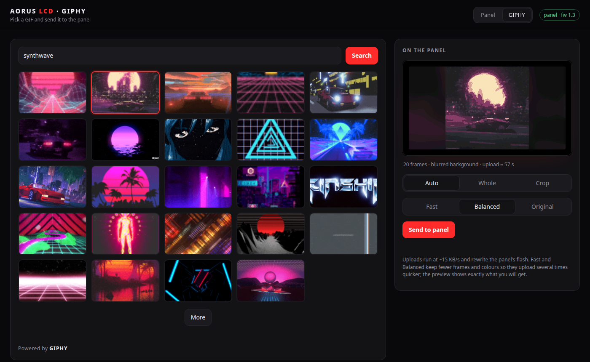
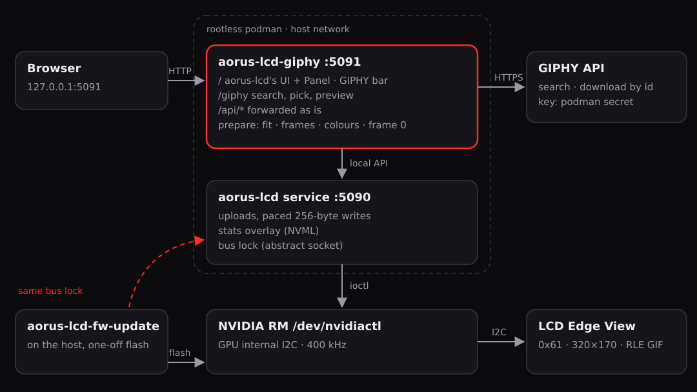
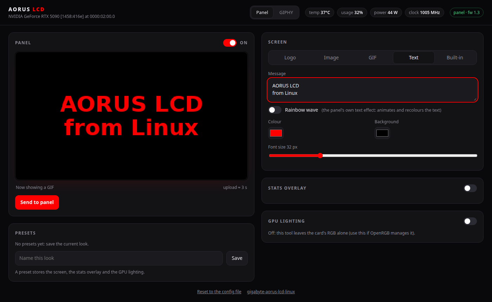
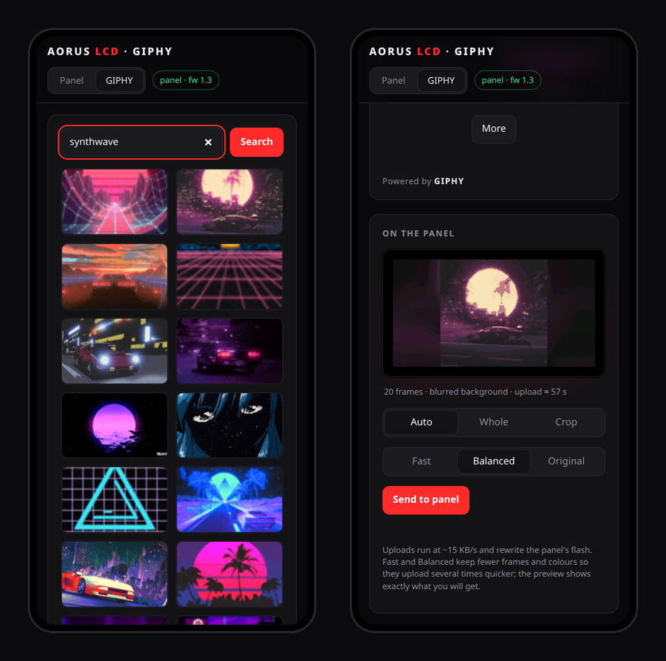
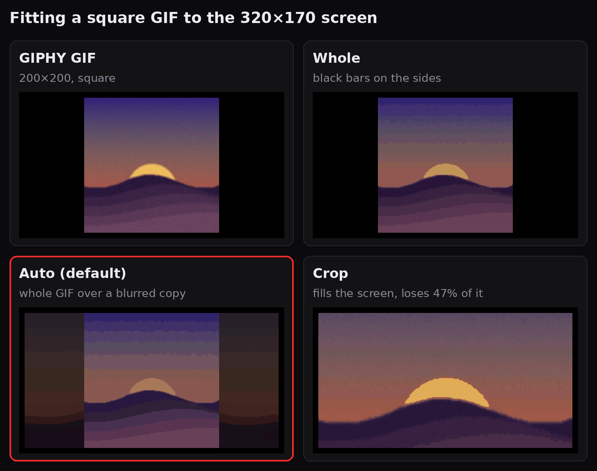
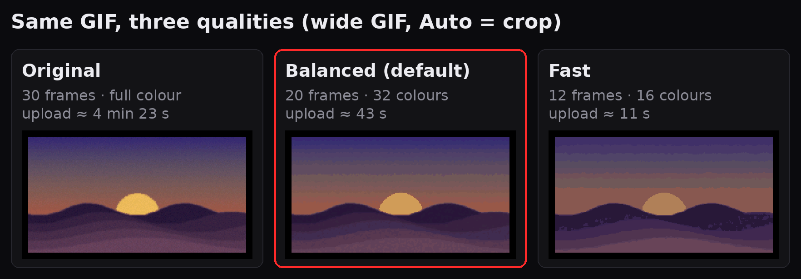
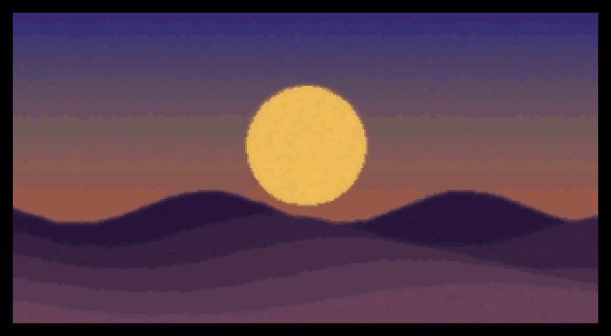

# aorus-lcd-extras

**English** · [Español](README.es.md)

Add-ons for [`aorus-lcd`](https://github.com/c-drew/gigabyte-aorus-lcd-linux), which drives the
**LCD Edge View** side screen from Linux:

- **`aorus-lcd-fw-update`**: update the panel firmware on a working panel (below).
- **A rootless container** for `aorus-lcd`'s service and web UI, to change what the screen
  shows ([Run the panel service in a container](#run-the-panel-service-in-a-container)).
- **`aorus-lcd-giphy`**: a page to search GIPHY and send a GIF to the panel
  ([GIPHY](#giphy)).



## Firmware update

Update the firmware of the **LCD Edge View** side screen on a Gigabyte **AORUS GeForce RTX 5090
MASTER** from Linux, on a panel that is **working normally**. No Windows, no Gigabyte Control
Center, no root.

```bash
aorus-lcd-fw-update extract GV-N5090AORUSM-32GD_LCD_F1.3.exe -o lcd-f1.3.bin
aorus-lcd-fw-update flash lcd-f1.3.bin          # checks only, writes nothing
aorus-lcd-fw-update flash lcd-f1.3.bin --yes    # ~2 minutes, don't power off
```

```
panel:  firmware 1.1
asking the panel to reboot into its bootloader ...
panel acked 01 5a fe a5; bootloader at 0x22
flashing, 1-3 minutes. Do not power off.
  7334/7334
done: panel firmware 1.3
```

## Why this exists

[c-drew/gigabyte-aorus-lcd-linux](https://github.com/c-drew/gigabyte-aorus-lcd-linux)
(`aorus-lcd`) already drives the panel from Linux and can reflash it byte-for-byte the way
Gigabyte's updater does, but only when the panel's MCU is **already stuck in its IAP
bootloader**. A healthy panel runs its application at I2C `0x61`, and nobody had documented how
Gigabyte's updater sends it to the bootloader. This project adds exactly that step and then
hands over to `aorus-lcd`'s verified flash plan. It is a small add-on, not a fork.

## The missing step: `I2CAPChangeToIAP`

Recovered from `GvLcdFwUpdate.dll`, which ships inside the official
`GV-N5090AORUSM-32GD_LCD_F1.3.exe`:

1. `I2CAPChangeToIAP` (RVA `0x35B0`) builds `{cmd = 0x8101, length byte = 4}` and calls the
   frame writer at `0x4060`. `I2CIAPChangeToAP` (`0x8102`) uses the same writer, and
   `aorus-lcd` already reproduces that one, verified in an emulator. The writer appends `~cmd`
   and a CRC-16/XMODEM over the `[len][crc]` block, with the CRC field zeroed. On the wire, to
   `0x61` (`0xC2` in 8-bit form):

   ```
   01 81 FE 7E 04 00 F1 CA
   ```

2. The writer waits 100 ms, then **reads 4 bytes from the application address** (helper
   `0x3B30`, a plain read with no write first) every 1 ms, up to 3000 times, until the reply is
   non-zero. The panel answers `01 5A FE A5` and reboots into its bootloader.
3. The vendor flow sleeps 500 ms and starts talking to the bootloader at `0x22` (fallback
   `0x23`). From that point on it is `aorus-lcd`'s `firmware.plan_flash`, unchanged.

**The read in step 2 matters.** On the first attempt this tool sent the frame and then only
pinged the bus with an address-only write. The panel ignored the request and stayed on its old
firmware, and nothing was erased. With the read, it switched to the bootloader immediately.
The panel firmware's own handler matches this too
([EKYavsil's analysis](https://github.com/EKYavsil/aorus-lcd-panel-reverse-engineering)): it
looks for an 8-byte message starting with `0x8101 0x7EFE`.

Byte 5 of the frame is left uninitialised on the DLL's stack; this tool sends `0x00`. The panel
only checks the first two half-words.

You can check all of this against your own download, without running anything from Gigabyte:

```bash
.venv/bin/pip install -e '.[verify]'
.venv/bin/python -I tools/verify_dll.py GV-N5090AORUSM-32GD_LCD_F1.3.exe
# I2CAPChangeToIAP: cmd 0x8101, length byte 4, writer 0x180004060
# I2CIAPChangeToAP: cmd 0x8102, length byte 0, writer 0x180004060
# OK: matches aorus_lcd_fw_update.update.FRAME
```

## Status

Tested **once**, on one card: AORUS GeForce RTX 5090 MASTER 32G (PCI subsystem `1458:416e`),
LCD firmware **1.1 → 1.3**, NVIDIA driver 615.78.08, Bazzite (Fedora 44, kernel 7.2). Reports
from other cards are welcome.

Only images that `aorus-lcd` knows by SHA-256 are accepted, and only on the card they belong to.
Today that means F1.3 for `1458:416e`, which is the newest LCD firmware on Gigabyte's support
page for this card. The F1.4 and F1.5 builds you may find online belong to the MASTER ICE and
STEALTH ICE models.

## Install

Needs Python 3.11+ and the NVIDIA driver (open or proprietary). Access goes through
`/dev/nvidiactl`, like the NVIDIA userspace libraries, so no root and no i2c-dev are needed.

```bash
git clone https://github.com/jfrmorales/aorus-lcd-extras
cd aorus-lcd-extras
python3 -m venv .venv && .venv/bin/pip install -e .
```

Get the updater from Gigabyte's support page for your card (*Support → Firmware → LCD
Firmware*). `extract` only parses the .NET resources; nothing from Gigabyte is executed, and no
Gigabyte file is included in this repository.

## Run the panel service in a container

`aorus-lcd` also has a service with a web UI to change what the screen shows (logo, image, GIF,
text, built-in stat screens), the GPU-stats overlay and the card's RGB. This repository can
run it as a rootless container, served at `http://127.0.0.1:5090/` and nowhere else. Flashing
stays on the host: it is a one-off command, and a container restart must never cut it short.



Needs podman (or docker) and the NVIDIA Container Toolkit's CDI spec
(`nvidia-ctk cdi generate`), which provides the NVIDIA devices and a `libnvidia-ml` matching
the running driver for the overlay's live stats.

```bash
podman build -t localhost/aorus-lcd -f Containerfile .
podman compose up -d                  # or docker compose; or, without compose, Quadlet:
cp contrib/aorus-lcd.container ~/.config/containers/systemd/
systemctl --user daemon-reload && systemctl --user start aorus-lcd
```

Two settings in `compose.yml` and the Quadlet unit are required, not cosmetic:

- **`network_mode: host`**. `aorus-lcd`'s bus lock is an abstract Unix socket, and those belong
  to a network namespace. In a namespace of its own, the service would not see a `flash`
  started on the host, and both would write to the bus at once. Host networking also keeps the
  UI on the host's loopback, which is what `aorus-lcd`'s DNS-rebinding check expects.
- **`label=disable`**. Without it, SELinux denies the container access to the NVIDIA devices.

UI choices and uploaded media live in the `aorus-lcd-state` volume. To start from a config
file, mount it at `/etc/aorus-lcd/config.toml` (see the commented line). The bus lock already
keeps a flash and the service apart, but stop the service before flashing anyway:
`systemctl --user stop aorus-lcd` or `podman compose down`.

The panel UI as served at `http://127.0.0.1:5091/` (see [GIPHY](#giphy)), with the *Panel ·
GIPHY* bar in its header. The preview here is a text, rendered without sending anything:



## GIPHY

`aorus-lcd-giphy` gives the panel **one address, `http://127.0.0.1:5091/`**, with a *Panel ·
GIPHY* bar on top. *Panel* is `aorus-lcd`'s own UI, served through it unchanged, and `/api/` is
forwarded to the service. *GIPHY* (`/giphy`) searches GIPHY (empty search = trending), shows
the GIF at the panel's 320×170 and colour depth with the upload estimate, and sends it. It
never touches the bus: everything goes through the `aorus-lcd` service's local API, which
keeps owning the panel and its bus lock. The service's own address (`:5090`) still works.

<p align="center"></p>

Get an **API** key (not an SDK key) at [developers.giphy.com](https://developers.giphy.com/),
then store it as a podman secret and start the unit; it runs from the same image:

```bash
read -rsp 'GIPHY API key: ' K && printf %s "$K" | podman secret create giphy_api_key - && unset K
cp contrib/aorus-lcd-giphy.container ~/.config/containers/systemd/
systemctl --user daemon-reload && systemctl --user start aorus-lcd-giphy
```

With compose, put `GIPHY_API_KEY=...` in a `.env` file (git-ignored). The key stays on the
server; the browser only sees GIF ids and GIPHY media URLs, and downloads are limited to
`https://*.giphy.com`. `GIPHY_RATING` (`g`, `pg`, `pg-13`, `r`; default `pg`) and `GIPHY_LANG`
(default `es`) tune the search.

### Favorites

Tap ☆ on any GIF, or *Add to favorites* under the preview, to keep it; **★ Favorites** next to
Search shows them, ready to send again. They live on the server, in the
`aorus-lcd-giphy-state` volume, so every browser sees the same list. Only the GIPHY id, title
and thumbnail URL are kept: the GIF is fetched from GIPHY again when it is sent.

### Light GIFs and the GIPHY quota

Every result gets a badge with its upload time at the current fit and quality: green up to
30 s, amber up to 90 s, red above. **⚡ Light only** keeps the green ones. The server measures
each GIF by running four of its frames through the real pipeline; on 63 GIPHY results that
was within about a second of the full calculation and found every GIF of 30 s or less.

A GIPHY beta key allows **100 API calls an hour**, and only searching spends them: one per
search or *More*. Searches and trending are reused for 15 minutes, and measuring, previewing,
sending and favorites download from GIPHY's CDN with the URL the search already returned,
which costs nothing. The footer shows the calls used in the last hour; if the quota runs out
the page says so, and a production key from GIPHY lifts the limit.

### Filling the screen

GIFs are usually square or 16:9; the panel is almost 2:1. **Auto** (the default) crops when
that loses at most 20% of the picture, which is the case for most wide GIFs. Otherwise it shows
the whole GIF over a blurred, darkened, enlarged copy of itself: no bars and no stretching, at
about the same upload cost. *Whole* and *Crop* are there when you want one or the other.



### Upload time and quality

Uploads move at ~15 KB/s (256-byte writes, paced, plus flash erases), and the panel's RLE only
shrinks runs of identical pixels, which photographic, dithered GIFs hardly have: sent as is, a
100-frame GIPHY result takes 8 minutes. So each GIF is prepared on the server first, and the
preview shows exactly what will be sent:

- fewer frames, spread over the whole GIF so it keeps its length;
- a median filter that removes the dither noise breaking RLE runs;
- a small palette without dithering, so flat areas become runs.



| Quality | Frames | Colours | Measured on 6 GIPHY results |
|---|---|---|---|
| Fast | 12 or more | 16, median filter 5 | 15-73 s |
| **Balanced** (default) | 20 or more | 32, median filter 3 | 27-113 s |
| Original | all | full | 1-8 min |

The page warns when an upload would take more than 2 minutes. This is what the panel plays for
the example above, at Balanced (20 frames, 2× zoom):

<p align="center"></p>

### What the panel does with a GIF

Two firmware quirks, seen on the panel (LCD firmware 1.3), that the preparation works around:

- **It never shows the first frame**: the loop starts at, and goes back to, frame 1. A black
  frame goes first; RLE packs it into a few bytes.
- **One delay for every frame, in ms, in one byte**: 255 ms at most. A slower frame would be
  cut short and the GIF would play too fast, so a GIF keeps as many frames as it needs to stay
  at or under 250 ms each. That is why "or more" in the table: long GIFs cost more.

## Safety

- **Before anything is erased**, the tool checks the image hash, that the image belongs to this
  card, and that the panel application is answering. Without `--yes`, it stops there.
- If the panel does not enter the bootloader, the tool stops and nothing is erased.
- The bootloader area (`0x0000-0x0FFF`) is **never** erased. If the flash is interrupted, the
  panel stays black in its bootloader, and `aorus-lcd firmware flash lcd-f1.3.bin --yes`
  recovers it.
- The tool never reads the bootloader without first sending a status request: an idle read
  holds the bus until a full power-off.
- It holds `aorus-lcd`'s bus lock for the whole run, so the `aorus-lcd` service cannot
  interleave writes. Close Gigabyte Control Center and OpenRGB first.
- After the update, the panel may come back in Gigabyte's demo mode ("Hi AORUS" and animated
  GIFs), ignoring the first upload. Run `aorus-lcd mode 5`, or upload again. Gigabyte
  recommends a full power-off after an update.

This only touches the LCD's own microcontroller, never the GPU's VBIOS. Still, it is reverse
engineered and unofficial: use it at your own risk.

## Credits

- [c-drew/gigabyte-aorus-lcd-linux](https://github.com/c-drew/gigabyte-aorus-lcd-linux): the
  NVIDIA RM transport, bootloader protocol and flash plan this tool runs on (MIT).
- [albancreton/aorus-master-linux](https://github.com/albancreton/aorus-master-linux): the
  original Linux protocol work.
- [EKYavsil/aorus-lcd-panel-reverse-engineering](https://github.com/EKYavsil/aorus-lcd-panel-reverse-engineering):
  the updater's IAP flow and the panel firmware's `0x8101` handler.

Not affiliated with Gigabyte or NVIDIA. AORUS and LCD Edge View are Gigabyte trademarks.

## License

MIT, see [LICENSE](LICENSE).
